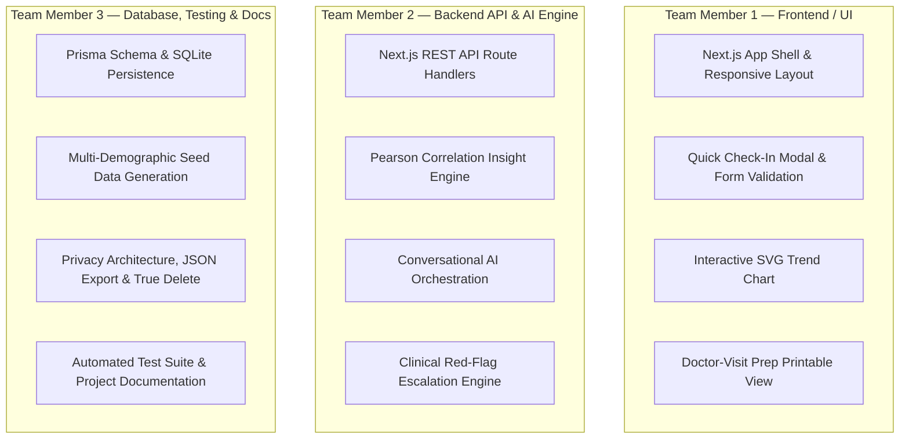

# HerHealth — Universal Well-Being Companion (30% MVP)

An AI-powered personal well-being companion for women's everyday health — cycle awareness (optional), mood, energy, fitness, nutrition, sleep, and body understanding — designed to work for **any woman, at any age, of any background, not tied to a specific reproductive life stage**.

Deliberately excludes high-stakes, narrow-audience modules (pregnancy, postpartum, TTC fertility optimization, and menopause-specific programs) in favor of **universal relevance, lower clinical risk, and architectural privacy**.

---

## 1. Project Overview & Core Loop

The core product loop is:
$$\text{Log (10s)} \longrightarrow \text{Understand (AI Engine)} \longrightarrow \text{Act (Plain-Language Advice)} \longrightarrow \text{Reflect (Timeline)}$$

Unlike legacy women's health apps that treat the menstrual cycle calendar as the prerequisite backbone, **HerHealth places the AI Insight Engine and AI Companion at the true center of the application**. Menstrual cycle tracking is an optional input signal that can be enabled or disabled without limiting the app's utility for non-menstruating women (e.g., teens, women on oral contraceptives, post-menopausal women, or those with hysterectomy or amenorrhea).

---

## 2. Implemented Features (30% MVP Review Ready)

| Feature | Implementation Status | Functional Details |
| :--- | :--- | :--- |
| **Quick Daily Check-In** | ✅ Fully Functional | 10-second check-in: Mood (1-5), Energy (1-5), Sleep Hours & Quality (1-5), Stress Level (1-5), Multi-select Symptoms, and Free-text notes. Cycle flow is an optional toggle. |
| **AI Insight Engine** | ✅ Fully Functional | Hero feature. Calculates multi-variable Pearson correlations (Sleep vs. Energy, Stress vs. Brain Fog/Bloating/Headache) and outputs non-prescriptive, body-neutral insight cards. |
| **Conversational AI Companion** | ✅ Fully Functional | Real-time chat grounded in user logs and curated clinical knowledge. Explains physiological mechanisms, translates medical terms, and maintains empathetic tone. |
| **Explain-My-Body Mode** | ✅ Fully Functional | Instant plain-language breakdown of common symptoms (fatigue, brain fog, tension headaches, bloating, sleep latency). |
| **Clinical Red-Flag Escalation** | ✅ Fully Functional | Automated detection of emergency symptoms (cardiac signs, neurological deficits, severe hemorrhage, psychiatric crisis). Bypasses app guidance to provide immediate 911 / 988 emergency routing. |
| **Doctor-Visit Prep Generator** | ✅ Fully Functional | One-click clinical summary generator: synthesizes 30-day vitals averages, symptom frequency matrix, AI correlations, and patient concerns into a print-ready (`window.print()`) medical brief. |
| **Health Timeline & Filter** | ✅ Fully Functional | Chronological longitudinal history view with filters for High Stress, Low Sleep, and Symptom occurrences. |
| **Privacy & Security Center** | ✅ Fully Functional | Separation of identity from health records using pseudonymous IDs (`HH-USER-...`), default-off research consent, 1-click portable JSON export, and single-click **True Delete** permanent purge. |
| **Universal Demographic Cohorts** | ✅ Fully Functional | In-header profile switcher enabling 1-click live demo switching between **Maya (21, Student)**, **Elena (37, Working Professional with Cycle Active)**, and **Sarah (58, Post-Menopause)**. |

---

## 3. Major Features Planned for Remaining 70%

- **Phase 2 (50% Milestone)**:
  - Preventive Care Concierge (age-tailored screening reminders for mammograms, Pap smears, bone density, lipid panels).
  - Mental & Emotional Well-Being guided reflection modules.
  - Multi-turn voice interaction for check-ins.
- **Phase 3 (75% Milestone)**:
  - Mobile Application via React Native + Expo sharing the existing TypeScript business logic and design tokens.
  - Optional Wearable Integrations (Apple Health, Google Fit, Oura, Whoop).
  - Condition-specific opt-in hubs (PCOS, thyroid, autoimmune, endometriosis).
- **Phase 4 (100% Final Release)**:
  - Pelvic Floor, Sexual Wellness, and Skin & Body Confidence optional modules.
  - HIPAA BAA compliant cloud backend with end-to-end zero-knowledge encryption.
  - Moderated peer-support community layer.

---

## 4. Technology Stack (Actually Implemented)

- **Frontend**: Next.js 14.2 (App Router), React 18, TypeScript, Tailwind CSS, Lucide React icons.
- **Backend API**: Next.js API route handlers (`/api/check-in`, `/api/insights`, `/api/companion`, `/api/doctor-prep`, `/api/privacy`, `/api/users`).
- **Database & ORM**: Prisma ORM with SQLite (`prisma/dev.db`), completely zero-configuration and local, with PostgreSQL-compatible schema.
- **AI Orchestration & Safety**: Multi-variable statistical correlation engine (`insightEngine.ts`) + clinical safety and emergency escalation parser (`redFlags.ts`) + grounded conversational knowledge base (`aiCompanion.ts`). Supports Anthropic Claude or Google Gemini API keys via environment variables, with offline fallback simulation.
- **Testing**: Automated TypeScript test runner (`tsx src/lib/test-runner.ts`).

---

## 5. Project Directory Structure

```
HerHealth/
├── prisma/
│   ├── dev.db                 # Local zero-config SQLite database
│   ├── schema.prisma          # Database schema (User, DailyCheckIn, SymptomLog, etc.)
│   └── seed.ts                # Multi-demographic seed data (Maya 21, Elena 37, Sarah 58)
├── src/
│   ├── app/
│   │   ├── api/
│   │   │   ├── check-in/route.ts      # Log submission and query API
│   │   │   ├── companion/route.ts     # Conversational AI API
│   │   │   ├── doctor-prep/route.ts   # Clinical summary generation API
│   │   │   ├── insights/route.ts      # Statistical correlation API
│   │   │   ├── privacy/route.ts       # Consent, JSON export, and True Delete API
│   │   │   └── users/route.ts         # User profiles API
│   │   ├── companion/page.tsx         # AI Companion & Explain-My-Body interface
│   │   ├── doctor-prep/page.tsx       # Doctor-Visit Prep Generator (Print-ready)
│   │   ├── globals.css                # Styling, scrollbars, and @media print rules
│   │   ├── layout.tsx                 # App layout with responsive navigation
│   │   ├── page.tsx                   # Main Dashboard (Vitals, Insights, Trends)
│   │   ├── privacy/page.tsx           # Privacy & Security Control Center
│   │   └── timeline/page.tsx          # Health Timeline & Longitudinal log history
│   ├── components/
│   │   ├── CheckInModal.tsx           # 10-second check-in modal
│   │   ├── ChatInterface.tsx          # AI Companion chat component
│   │   ├── InsightCard.tsx            # AI insight card with correlation badge
│   │   ├── Navbar.tsx                 # Navigation bar with responsive menu
│   │   ├── ProfileSwitcher.tsx        # 1-click universal demographic cohort switcher
│   │   ├── RedFlagAlert.tsx           # Clinical emergency escalation banner
│   │   └── TrendChart.tsx             # Interactive SVG longitudinal correlation chart
│   └── lib/
│       ├── aiCompanion.ts             # AI Companion logic & clinical knowledge base
│       ├── doctorPrep.ts              # Physician report aggregation engine
│       ├── insightEngine.ts           # Multi-factor correlation algorithm
│       ├── prisma.ts                  # Prisma client singleton
│       ├── redFlags.ts                # Emergency symptom detection & hotlines
│       ├── test-runner.ts             # Automated test suite
│       └── types.ts                   # Shared TypeScript data contracts
├── package.json
├── tailwind.config.ts
├── tsconfig.json
└── README.md
```

---

## 6. Setup & Execution Instructions

### Prerequisites
- Node.js (v18+ or v20+ recommended)
- npm

### Step 1: Install Dependencies
```bash
npm install
```

### Step 2: Initialize Database & Seed Demo Data
```bash
# Push schema and create SQLite database
npm run db:push

# Seed the database with Maya (21), Elena (37), and Sarah (58) realistic 14-day logs
npm run db:seed
```

### Step 3: Run Automated Verification Tests
```bash
npm test
```
*Executes all 12 automated unit and integration tests for red-flag escalation, Pearson correlation math, and doctor prep generation.*

### Step 4: Start the Development Server
```bash
npm run dev
```

### Step 5: Access the Application
Open your browser and navigate to:
```
http://localhost:3000
```

---

## 7. Demonstration Guide for Project Review

1. **Universal Relevance Demo (Profile Switcher)**:
   - In the top navigation bar, click the cohort switcher (currently showing **Maya, Age 21**).
   - Switch to **Sarah (Age 58)**: Note that the cycle calendar is completely disabled, and her dashboard highlights joint stiffness, sleep quality, and energy recovery.
   - Switch to **Elena (Age 37)**: Note how cycle tracking gracefully appears as an optional signal, showing luteal transition correlations alongside her work stamina.
2. **10-Second Daily Check-In**:
   - Click the **"Daily Check-In"** button in the header or dashboard.
   - Select Mood (4), Energy (3), Sleep (8 hrs), Stress (2), select symptoms (*Fatigue*, *Brain Fog*), add an optional reflection note, and click **Save Daily Check-In**.
   - Watch the dashboard immediately refresh with the newly logged data.
3. **AI Insight Engine (Hero Feature)**:
   - Review the AI Insight cards on the dashboard. Observe statistical correlation badges (e.g., $r = +0.78$) detailing how sleep hours correlate with daytime energy.
4. **Conversational AI Companion & Explain-My-Body**:
   - Navigate to `/companion`. Click prompt suggestion chips like *"Why do I feel so exhausted in the afternoons?"* or *"What causes brain fog?"*.
   - Review the plain-language, evidence-based physiological translation.
5. **Clinical Red-Flag Safety Escalation**:
   - In the AI Companion chat, type an acute emergency symptom: *"I have crushing chest pain and left arm numbness"*.
   - Observe the immediate red-flag safety alert banner with emergency hotline routing (911 / 988), proving the app will never dangerously diagnose or dismiss emergency symptoms.
6. **Doctor-Visit Prep Generator**:
   - Navigate to `/doctor-prep`. Review the auto-generated 30-day baseline vitals, symptom matrix, and high-yield questions for the doctor.
   - Click **"Print / Save as PDF"** to preview the clean one-page clinical brief.
7. **Privacy Control Center**:
   - Navigate to `/privacy`. Toggle granular consent settings, test the **One-Click JSON Data Export**, or demonstrate the **True Delete** permanent purge.

---

## 8. Division of Work Among 3 Team Members



---

## 9. Future Development Roadmap

- **30% (Current MVP)**: Core platform, daily check-in, AI Insight Engine, AI Companion with red-flag safety, Doctor-Visit Prep, Timeline, Privacy Center, 3 demographic cohorts.
- **50% Milestone**: Preventive Care Concierge, guided reflection journal with NLP sentiment extraction, nutrition & movement recommendations.
- **75% Milestone**: Mobile companion app (React Native/Expo) sharing core TypeScript logic; wearable device syncing (Apple Health, Oura, Google Fit); opt-in chronic condition hubs (PCOS, thyroid).
- **100% Milestone**: Pelvic floor and sexual wellness modules; HIPAA BAA cloud certification; peer-moderated community forums with credentialed women's health clinicians.
